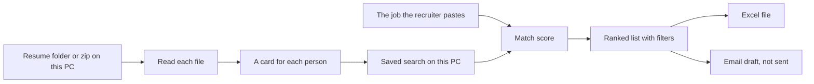

# Architecture review — Talent Scout Desktop

Reviewed: 19 October 2026. Build reviewed: v0.1.0 (commit `a81c117`), source in this desktop repository. The cloud site was not part of this review.

Reviewer role: senior architect, then a non-technical recruiter reading the same screens.

## What a recruiter or manager can read

Talent Scout Desktop is one program on the recruiter’s own Windows laptop. There is no office server and no account to sign up for.

The recruiter’s path should be four steps:

1. Pick the folder that holds the resumes.
2. Paste the job.
3. Look at the ranked list and narrow it.
4. Download Excel, or write a reply that stays as a draft.

Reading happens on this computer. A second look at the same folder skips files that have not changed. A bad file is listed and the rest continue. Scores come from written rules (skills, years, city), not from sending resumes to a cloud model.

The pieces inside the program are small on purpose:

| Piece | Plain meaning |
| --- | --- |
| Window | The four steps the recruiter sees |
| Reader | Opens PDF, Word, RTF, text, and zip |
| Rules | Pulls name, email, phone, city, skills, company, years, notice |
| Match | Turns the job into a score from 0 to 100 |
| Saved search | One local file of the current search |
| Excel | The rows on screen, same column names as the list |

What this version does not do yet, and must not pretend to do: read a photo of a resume, log into Naukri or any other job site, or send email by itself.

## Findings

Every Critical and High item has a concrete change. No item below is “consider later” without a fix.

### Critical

**A-C1. Candidate details sit in an unlocked file.**
The saved search is a normal SQLite file (`scout.db`) under the app data folder. Name, email, phone, company, and the resume path are readable by anyone who can open that folder. That is personal data under India’s DPDP Act, kept with no lock.
Change: encrypt those fields before they are written. Keep the lock in Windows Credential Manager (Keychain on a Mac). If the lock cannot be saved, stop and say so in one sentence. Do not fall back to a password written beside the database. Add a test that opens the database file as text and does not find a sample email.

**A-C2. A broken saved search crashes the program at startup.**
`open_db(...).expect("database")` ends the process if the file cannot be opened. The recruiter sees a window that never appears.
Change: catch that failure, show “The saved search on this computer could not be opened. Choose Start fresh to begin again.”, and offer that action. Do not show the Rust panic text.

### High

**A-H1. Old candidates are never removed.**
Choosing a new folder only changes which rows are shown. The previous people stay in the file. There is no Start fresh, no question before replacing the current search, and no expiry.
Change: when the folder is different from the current search, ask “Start a new search? People from the previous folder will be cleared from this computer.” On yes, delete the previous rows. Add Start fresh, which deletes the saved search, drafts, and download log. On startup, if the saved search is older than 7 days, clear it and say why.

**A-H2. A job with no skills gives everyone a high skill score.**
If the job text has no recognised skill, the match math treats “nothing required” as a full skill score (`ratio` returns 1 when the count is 0). A very short job can rank a poor fit near the top.
Change: when the job lists no skills, do not award skill points. The sentence under the score must say “This job did not list skills, so skills were not scored.”

**A-H3. Notice wording recruiters actually see is missed, and the list does not show days.**
“LWD 15 Nov”, “60 days”, and “serving notice” are not turned into a day count unless the word “notice” sits in a lucky place. The grid and Excel show the original phrase (`notice_raw`), while filters use a hidden day count. The same person can look like “2 months” on screen and be included in “60 days” only by luck.
Change: read immediate as 0 days, “N days/weeks/months” as a day count (a month is 30 days), “serving notice” as its own label when no date is known, and “LWD 15 Nov” as the number of days from today. Show that same day text in the list, the filter, and Excel.

**A-H4. One huge file can stall the whole folder.**
Every file is read fully into memory. Zip entries are capped. A normal PDF or text file is not. A multi-hundred-megabyte file occupies a worker and the memory of the laptop.
Change: skip a single file over 15 MB with the sentence “This file is too large to read. Split it or send a smaller copy.” Keep the zip caps, and list a skipped zip entry instead of dropping it quietly.

**A-H5. A failed read can look like success.**
The background read ignores the error returned by `ingest_path` (`let _ = ingest::ingest_path(...)`). If saving fails halfway, the window can sit on “running” until the thread ends with no explanation.
Change: on failure, set the progress state to done, and show one sentence: “The folder could not be finished. Start the folder again. Files already read are kept.”

**A-H6. Reply and portal steps are missing from the journey the recruiter was promised.**
The window ends at Excel. There is no email draft, and no way to bring profiles in from a portal. A live portal login is out of bounds (no stored portal passwords, no scripted sign-in).
Change: add step 4 as two plain actions. “Write a draft” saves an unsent email on this computer and never contacts a mail server. “Sample portal” runs a built-in mock list for the job, lets the recruiter pick rows, and copies those resumes into a folder they choose. Duplicate emails are skipped. A download log records counts only, not message bodies. Record in the summary that a live job portal was not connected.

**A-H7. Errors from the PDF reader are engineer text.**
A locked or broken PDF returns the library’s own message. The main screen can show that string.
Change: map reader failures to one sentence each. Locked or unreadable PDF: “This PDF could not be read. Ask for an unlocked copy.” Picture: “This is a photo, so it was skipped.” Empty file: “This file is empty.” Other type: “This file type cannot be read. Use PDF, Word, or text.”

**A-H8. The same idea has different names, and the first screen is not the four-step journey.**
The window says “Rank profiles”, “Must-have weight”, “Skill Set”, “Previous Company”, “unreadable”, and “files per minute”. Excel repeats “Skill Set” and “Previous Company”. A new recruiter has to guess which control is next, and the match weights sit in the main flow.
Change: use the glossary below in the window, Excel header row, messages, and this document. Main screen: Pick folder, Add the job, See ranked candidates, Export or reply. Move the four weights under a closed “Advanced” section. Defaults stay 60 / 20 / 10 / 10.

### Medium

**A-M1. Duplicate people are shown as separate rows.**
The same email in two files becomes two ranks.
Change: keep both files, mark the later row “Same email as another person in this search”, and say so in the list.

**A-M2. A name written in letters outside basic English is left blank.**
`looks_like_name` allows only ASCII letters. A name such as “José Alvarez” or a name in another script becomes empty even when the line is clearly a name.
Change: accept Unicode letters. Still refuse a line that contains `@` or looks like a sentence.

**A-M3. Only the first email and the first mobile are kept.**
A resume with a personal and a work email keeps whichever appears first. The phone scan can also stop on the first valid mobile.
Change: prefer a line labelled email, mobile, or phone. Keep the first valid value after that preference. Extra addresses stay out of the score. Do not guess.

**A-M4. Old `.doc` files are a best-effort scrape.**
The reader walks the bytes for readable words. A real Word `.doc` with a table often yields a partial card, with blank fields rather than a clear failure.
Change: if the scrape finds no email and no name, say “This older Word file could not be read. Save it as .docx and add it again.” Do not invent fields.

**A-M5. Photos and scans are skipped.**
There is no scanner program in the installer. That avoids a second install, and it also misses photographed resumes.
Change: keep the skip. The message in A-H7 is the recruiter-facing behaviour. Do not download a separate OCR tool in this fix.

**A-M6. There is no record of what the program did.**
Support cannot tell whether a folder was read or a draft was saved without opening candidate rows.
Change: append an audit line with the time, the action (“folder read”, “ranked”, “excel saved”, “draft saved”, “start fresh”), and counts. Never write a name, email, phone, or resume text into that log.

**A-M7. The sample job is filled in before the recruiter pastes anything.**
`sample_jd` runs at startup. The box looks like their job.
Change: start with an empty job box and the sentence “Paste the job here.” Keep “Try the sample resumes” as a separate button that also fills the sample job.

**A-M8. The installer is not signed and does not update itself.**
Windows shows “protected your PC” because there is no paid certificate. The setup is per user, includes the window component, and the uninstaller asks before deleting data (default is No). There is no in-app updater.
Change: keep the per-user setup and the uninstall question. Do not add an updater until a signing certificate exists, because an unsigned updater is a worse trust problem. Leave the SmartScreen sentence in the release notes. This item stays Medium and is deferred only for the certificate, not for the uninstall behaviour.

**A-M9. The size-and-time shortcut can skip a file whose content changed without a new timestamp.**
Unchanged size and modified time skips the file before the content hash. That is fast and right for normal copies. A tool that rewrites a file and restores the old timestamp would leave a stale card.
Change: keep the shortcut for speed. When the recruiter chooses Start fresh, hashes are irrelevant because the rows are deleted. Document the shortcut in the tester notes. Not worth hashing every file on every pass.

### Low

**A-L1. The progress bar is hidden from keyboard and screen-reader users.**
The bar is `aria-hidden`, and the status line is the real text. Contrast of body text `#1c2430` on `#f4f1ea` is strong. The error red `#8a2b2b` on white is readable. Font size is 16px.
Change: give the progress bar an accessible name (“Folder progress”) and keep the sentence beside it. Ensure every button is reachable with Tab.

**A-L2. “15 / 30 / 60 / 90 days” includes people who can join today.**
A 0-day notice passes a “30 days” filter. That matches “notice within 30 days”.
Change: label the choices “Up to 15 days”, “Up to 30 days”, and so on, so the meaning is obvious.

**A-L3. One database connection serves the whole window.**
Writes wait behind a single lock. For a few thousand resumes this is simpler and safer than a pool. It is not a second program to install.
Change: leave it. Do not add a service, a queue, or a second database.

## Recruiter simplification

- One journey: Pick folder → Add the job → See ranked candidates → Export or reply.
- Plain words from the glossary. No “ingest”, “workspace”, “parse”, “hash”, “weight” on the main screen.
- “Clear temporary data” and “workspace” are not used. The control is **Start fresh**. The thing they are working on is the **current search**.
- Defaults do the job: skill match 60, extra skills 20, experience 10, city 10, hidden under Advanced.
- One folder at a time. A new folder asks before it replaces the current search.
- Every failure uses this shape: what happened, why, what to do next. One sentence. No codes and no stack traces in the main text.
- Blank means “not found”. The program does not guess a name or a phone.
- Email is a draft on this computer until the recruiter opens it in their own mail program. This program does not send it.
- Portal results in this version are the built-in sample portal, clearly labelled, so nobody thinks a live job site was searched.

## Glossary

Use these words in the window, Excel, messages, and docs. Code identifiers may stay short; labels may not drift.

| Say this | Means | Do not say |
| --- | --- | --- |
| Current search | The folder and job open right now | Workspace, session, root |
| Resume folder | The folder the recruiter picked | Ingest path, corpus |
| Job | The text they pasted | JD, requisition |
| Candidate | One person from a resume | Profile, record, row (in the UI) |
| Match score | 0 to 100, higher is closer to the job | Rank score, confidence |
| Matching skills | Skills on both the job and the resume | Hits, overlap |
| Missing skills | Skills on the job that were not on the resume | Non-matching skills, gaps |
| Notice | How soon they can join, shown in days | Notice period raw |
| Company | The company written on the resume | Previous company, employer |
| Start fresh | Delete this computer’s saved search, drafts, and download log | Clear temporary data, reset cache |
| Email draft | An unsent message saved on this computer | Outreach, sequence |
| Sample portal | The built-in practice list, not a live job site | AI scrape, connector |
| Could not be read | This file was skipped and the others continued | Unreadable, parse error |

Notice display, everywhere:

| Situation | Show |
| --- | --- |
| Can join now | 0 days |
| A number of days, weeks, or months | `N days` (month = 30, week = 7) |
| Last working day dated | `N days` from today |
| Serving notice and no date | Serving notice |
| Not written | blank |

## Simplified architecture

One process. The window and the reader live together so a recruiter does not install Python, Docker, or a database server.

1. The recruiter picks a folder. The reader walks subfolders. Zip files are opened with a cap of 500 files, 8 MB each, 80 MB altogether, and paths that try to escape the zip are ignored.
2. Each new or changed file is read on several CPU cores. Size and modified time decide whether a file can be skipped. If the time changed, a content hash decides. A file that failed last time is tried again.
3. Rules pull the card. Unknown fields stay blank.
4. Cards are stored in the saved search with the candidate fields encrypted (A-C1).
5. The job is scored with the default weights. The list can be narrowed by notice, city, name, skills, company, and minimum score.
6. Excel writes the rows currently on screen, in match-score order, with the glossary headers.
7. Drafts and sample-portal copies stay on this computer. Nothing is uploaded.

Installer: one per-user Windows setup, built on a Windows build machine when a version tag is pushed. It includes the window component. Uninstall asks before deleting the saved search. Signing and self-update wait for a certificate (A-M8).

## Exit gate

Critical A-C1 and A-C2, and High A-H1 through A-H8, each have a concrete change above. Medium and Low items that are safe to do in the same pass are included in the fix phase. A-M5 and A-M8 stay as documented limits: no separate scanner program, no unsigned self-update.
